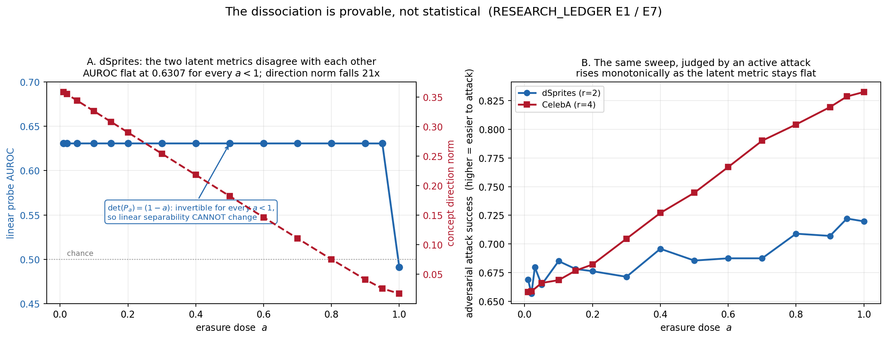

# Concept Unlearning in Variational Autoencoders

Code for my honours thesis, *Does Latent Geometry Reveal What a VAE Has Forgotten?*

If you train a VAE and then make it forget one concept, how do you know the concept is gone? Latent-space metrics such as probe accuracy, cluster purity and kNN cohesion are the usual answer. This project tests that answer against an active adversarial attack and a weight-space relearning test.

The two kinds of metric barely agree. A linear erasure method can leave the linear probe score exactly where it was while the concept direction shrinks twenty-fold, and an attacker finds the concept easier to recover as the erasure gets stronger.



## What was run

- **Datasets:** dSprites (forget hearts), CelebA (forget eyeglasses) and MPI3D-real (forget red objects).
- **Methods:** NegGrad+, fine-tuning, Feature Unlearning, RMU, Fisher scrubbing, LEACE and INLP, each compared with an oracle retrained without the forgotten concept.
- **Scale:** 249 models at two KL weights (β=1 and β=4).
- **Evaluations:** latent geometry, probes, disentanglement, membership inference (including U-LiRA), a latent-space adversarial attack and a weight-space relearning test.

## Layout

```
configs/       YAML configs for models, datasets and experiments
experiments/   training (train.py) and unlearning (unlearn/run.py, unlearn/tune.py)
src/           model, data loaders, training loop, unlearning methods, evaluation metrics
scripts/       evaluation runners, analysis scripts and data subsampling
tests/         CPU-only unit and regression tests
```

## Setup

```bash
pip install -r requirements.txt    # pinned versions are in requirements.lock.txt
python -m pytest                   # needs no data and no GPU
```

The datasets are not included.

- **dSprites** downloads on first use.
- **CelebA:** set `data_root` in `configs/dataset/celeba.yaml` to your copy of `img_align_celeba/`.
- **MPI3D-real:** run `python -m src.data.mpi3d --download`, then `--convert`.

`scripts/data/` has helpers for making the smaller subsets used here.

## Running it

Train a baseline and an oracle, then unlearn:

```bash
python experiments/train.py --experiment dsprites_baseline
python experiments/train.py --experiment dsprites_oracle
python experiments/unlearn/run.py --list
python experiments/unlearn/run.py --dataset dsprites --method rmu --epochs 10
```

Checkpoints go to `results/<dataset>/...`. A finished run leaves a `final.pt`, so rerunning it exits straight away and an interrupted sweep can be restarted safely. Evaluation runners are the `scripts/run_*.py` files.

Everything is seeded through `src/utils/seed.py`, with the seed set in `configs/base/training.yaml`.

## Status

The experiments are finished. The thesis is not published here yet, and this README will link to it once it is.

Code is released under the MIT licence.
